# Network Effects in Randomized Experiments: Simulations at Scale

Márton Trencséni

- Paper: [paper/paper.pdf](paper/paper.pdf)
- Companion tutorial: [paper/tutorial/tutorial.pdf](paper/tutorial/tutorial.pdf), *A Mathematics Tutorial on Social Network Experimentation*
- Earlier paper: [Monte Carlo Experiments of Network Effects in Randomized Controlled Trials](https://arxiv.org/abs/2312.01607) ([code](https://github.com/mtrencseni/mc-network-effects-rct))

## Abstract

On a social network, users post more when they see their friends post more. In an A/B test, this means that treating some users changes the behavior of control users as well, and the test no longer measures the effect of launching the treatment to everyone. This paper studies these effects on five families of random graphs with up to $10^9$ nodes and for two shapes of the response to content seen. We model each user's content production as $c = \lambda + \Delta\lambda z + \nu g(Ac)$: a baseline, plus the treatment effect, plus a response to what the user's friends post, either linear, $g(s) = s$, or logarithmic, $g(s) = K\log(1 + s/K)$, where each additional post seen adds less than the previous one. We compare the difference in means (DM) reported by the A/B test with the exact global average treatment effect (GATE) of a launch, and check a closed form for each effect. In the linear model a finite steady state exists only when $\nu\rho(A) < 1$, where $\rho(A)$ is the largest eigenvalue of the graph, so on heavy-tailed graphs a peer effect that looks safe by the mean degree becomes unstable as the graph grows. On graphs with homogeneous degrees the test reports about $1 - \nu\rho$ of the launch effect, running it longer does not close the gap, and cluster randomization narrows it. With the logarithmic response a finite steady state exists for every peer effect, and the test reports about $1 - \rho(J)$ of the launch effect, where $\rho(J) < 1$ is the largest eigenvalue of the matrix $J$ which describes how a small treatment spreads, and takes the place of $\nu\rho(A)$. Treatment that adds edges or users can make the test miss most of the effect.

## Figures

The figures of the main text, in the order they appear in the paper.

**Figure 1.** The network multiplies the treatment effect, and on every graph family the multiplier grows without bound as $\nu\rho(A)$ approaches 1.

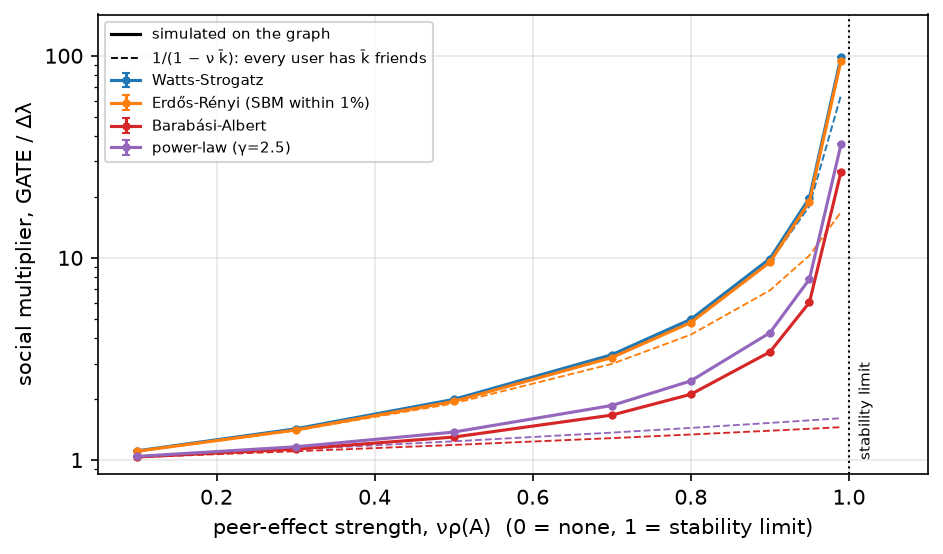

**Figure 2.** An A/B test with 10% of users treated reports about $1 - \nu\rho$ of the launch effect (dotted) on graphs without hubs;

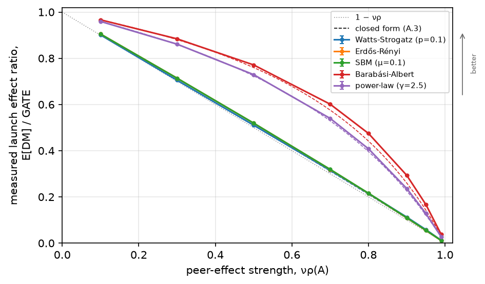

**Figure 3.** At the same peer effect per friend, $\nu\bar k$, the test reports less of the launch effect on graphs with hubs, and almost nothing as they approach their stability limit (dashed vertical lines, where $\nu\rho = 1$).

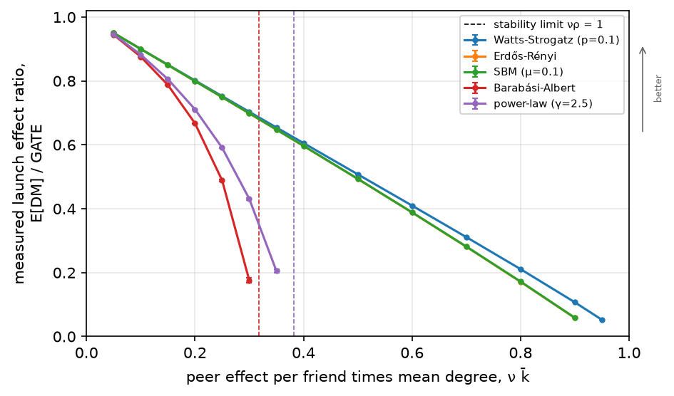

**Figure 4.** The share of the launch effect the test reports does not depend on the share of users treated ($\nu\rho = 0.5$).

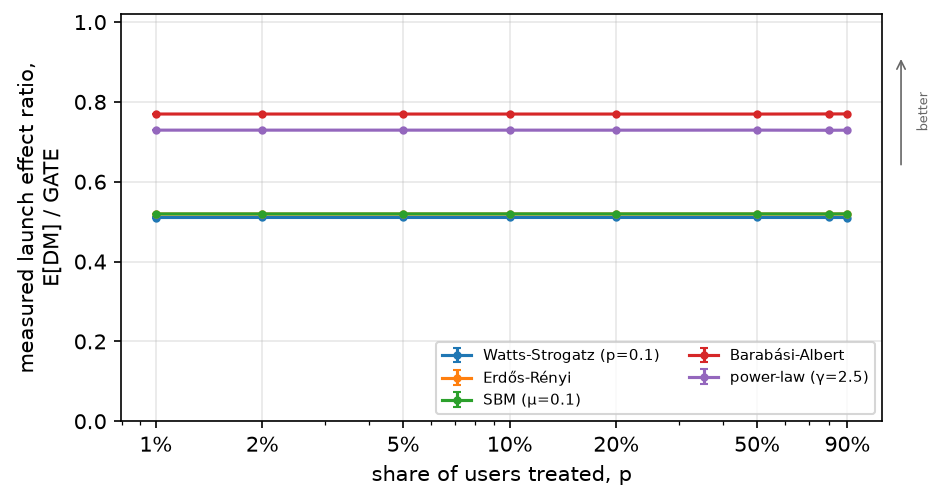

**Figure 5.** On graphs without hubs the test reports the same share of the launch effect at 10 thousand and at 100 million users.

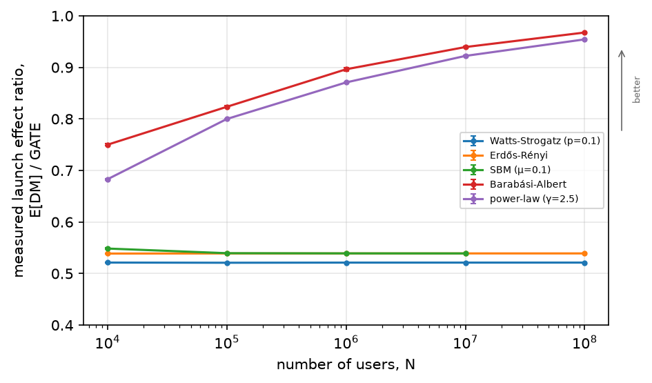

**Figure 6.** On graphs with hubs, a peer effect per friend that is stable on a small network is unstable on a larger one: at a fixed $\nu\bar k = 0.3$, $\nu\rho(A)$ grows with the number of users and crosses the stability limit (dashed).

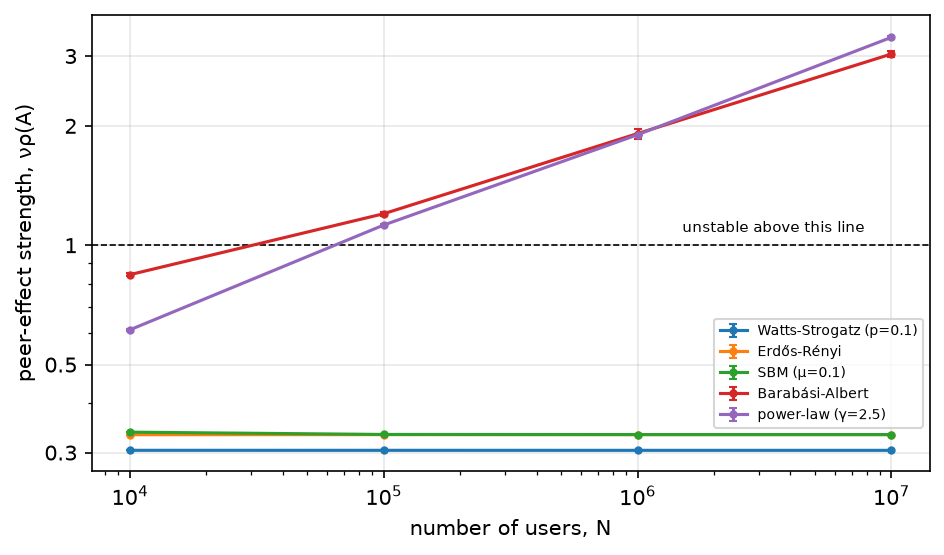

**Figure 7.** After launch, the launch effect keeps building up for many periods, the longer the closer $\nu\rho$ is to 1.

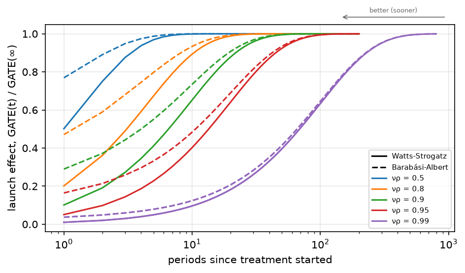

**Figure 8.** The A/B difference settles within the first periods, so running the test longer does not close the gap.

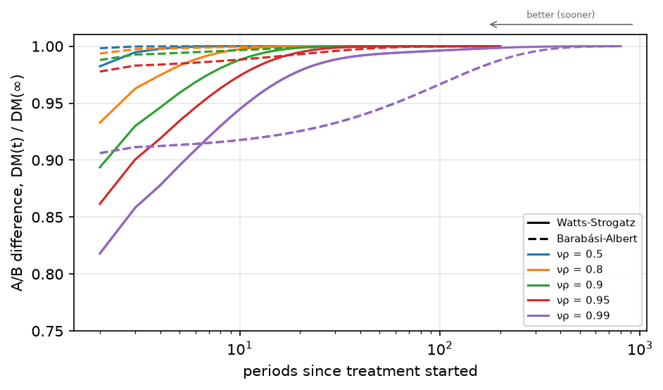

**Figure 9.** Treating whole clusters of friends together brings the test closer to the launch effect, in proportion to the share $\phi$ of friendships kept inside clusters ($\nu\rho = 0.5$).

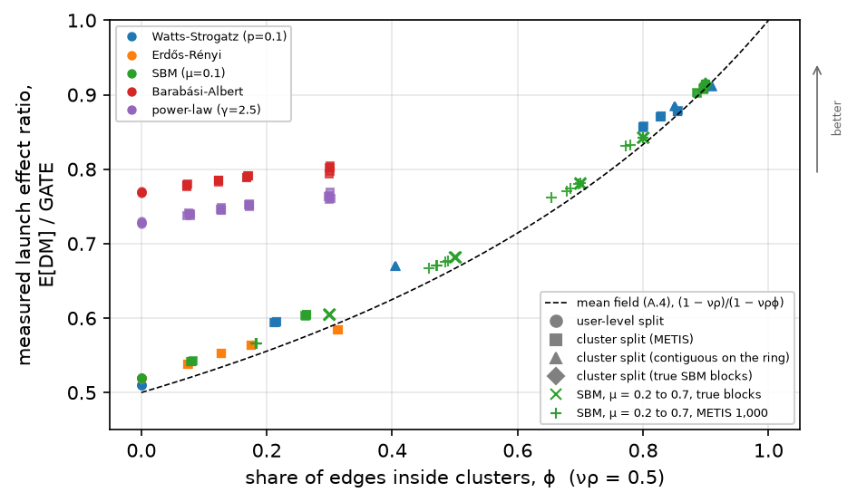

**Figure 10.** Clusters cut the error on graphs with communities or local clustering, barely help on Erdős-Rényi graphs, and with very large clusters make it worse on graphs with hubs.

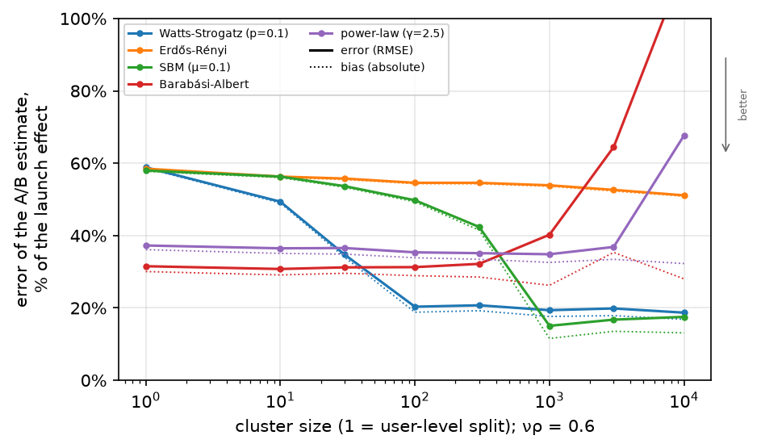

**Figure 11.** Two simple estimators recover the launch effect when the observation windows are comparable;

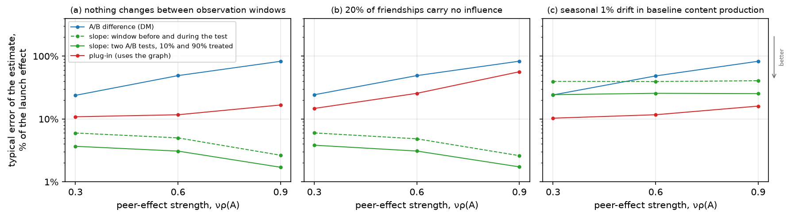

**Figure 12.** As $\nu\rho$ approaches 1 the launch effect (solid) grows without bound, while the A/B difference (dotted) stays near the direct effect $\Delta\lambda$.

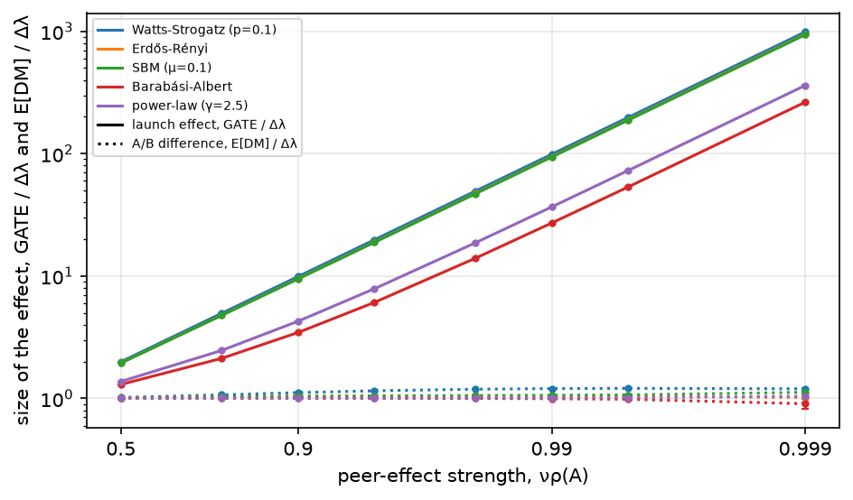

**Figure 13.** The test loses power near the stability limit;

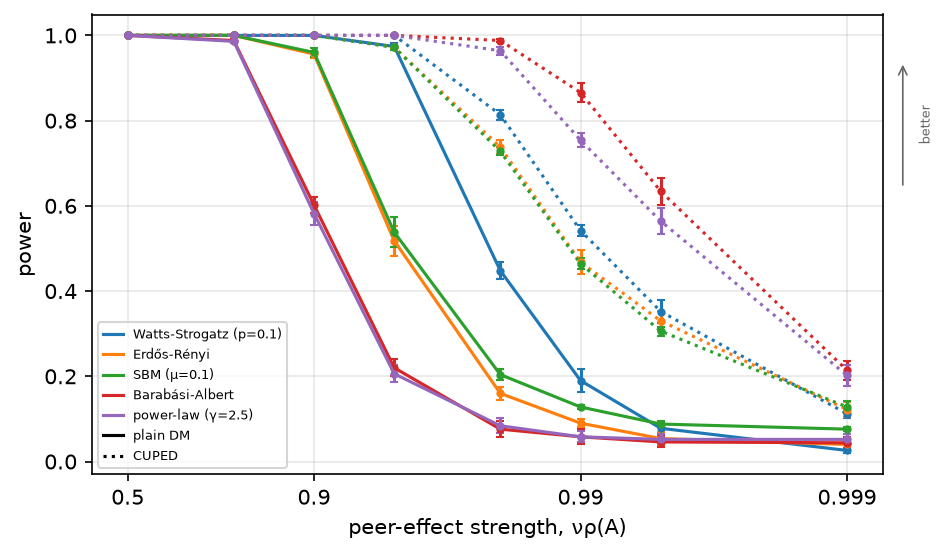

**Figure 14.** When the feature makes users add friends, the test reports a shrinking share of the launch effect as more friends are added.

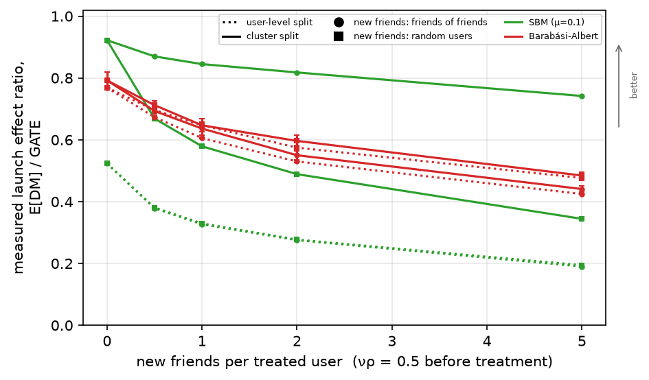

**Figure 15.** When the feature makes users invite new users, adding the new users' posts to the treated arm's total per original user (solid) captures the new users' own posts, which a launch adds too, and misses only the network effect, as in Section 4.2;

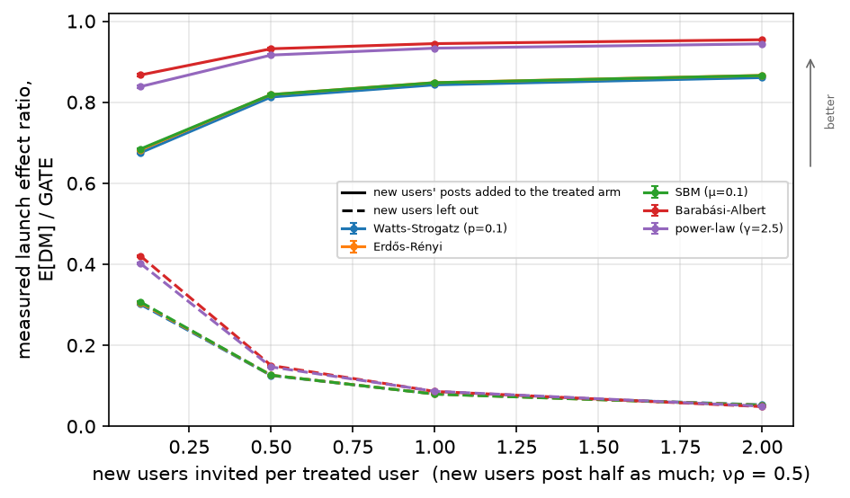

**Figure 16.** A behavior that spreads once enough friends adopt it: the test reports almost all of the launch effect below a critical treated fraction, and almost nothing above it.

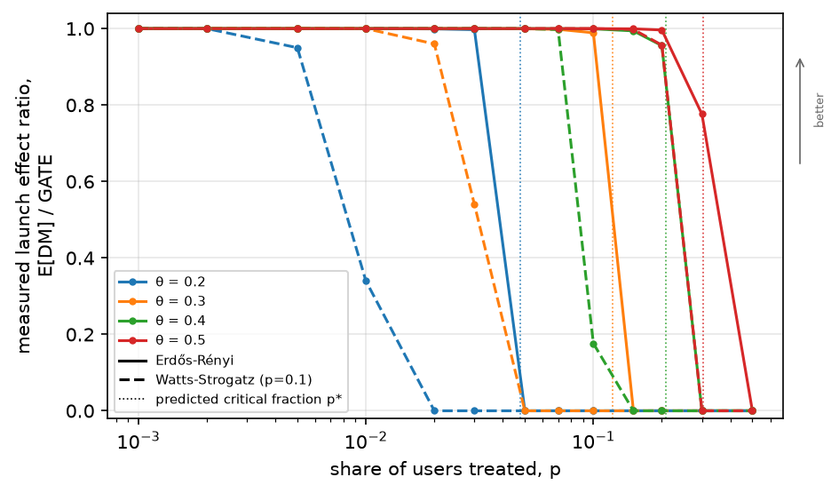

**Figure 17.** If each additional post a user sees adds less than the previous one, posting never grows without bound.

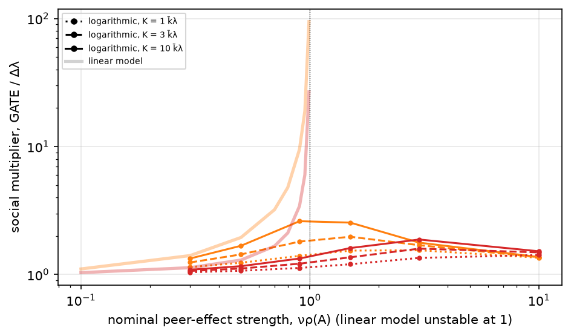

**Figure 18.** With a concave response the test reports about $1 - \rho(J)$ of the launch effect, as in the linear model with $\rho(J)$ in place of $\nu\rho$.

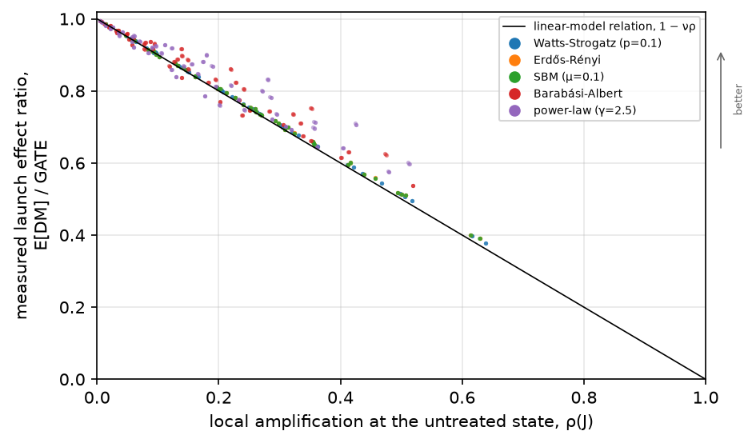

## Reproducing

```
python3 -m venv .venv
.venv/bin/pip install -r requirements.txt
make test        # unit tests of the simulator
make figures     # all figures, from the stored results in results/
make paper       # paper/paper.pdf from paper/paper.md (needs LaTeX with elsarticle)
make tutorial    # paper/tutorial/tutorial.pdf
```

`results/` holds the raw simulation outputs, so `make figures` and `make paper` do not rerun any simulation. To rerun them:

```
./run_all.sh
```

The experiments resume where they stopped: finished configurations are skipped. Most run on a laptop in minutes to hours. The graph-size runs at $10^8$ and $10^9$ nodes (`experiments/s13_giant.py`) need about 80 GB of memory and about an hour each.

## Layout

- `netfx/`: the simulator: graph generators, sparse steady-state solvers, designs, estimators and closed forms.
- `experiments/`: one script per group of experiments (`s5_effects.py` to `s14_family_table.py`), `theory_check.py` for the closed forms of Appendix B, and `figures.py`.
- `results/`: raw outputs of the experiments, one JSON line per configuration.
- `figures/`: the figures used in the paper.
- `paper/`: `paper.md` (source), `make_tex.py` (Markdown to LaTeX), `paper.tex` (generated) and `paper.pdf`; `tutorial/` holds the tutorial.
- `scripts/reproduce_2023.py`: reproduces every number and figure of the 2023 paper (Appendix D).
- `tests/`: unit tests.

## License

Code: MIT (see `LICENSE`). Paper and tutorial: CC BY 4.0 (see `paper/LICENSE`).
